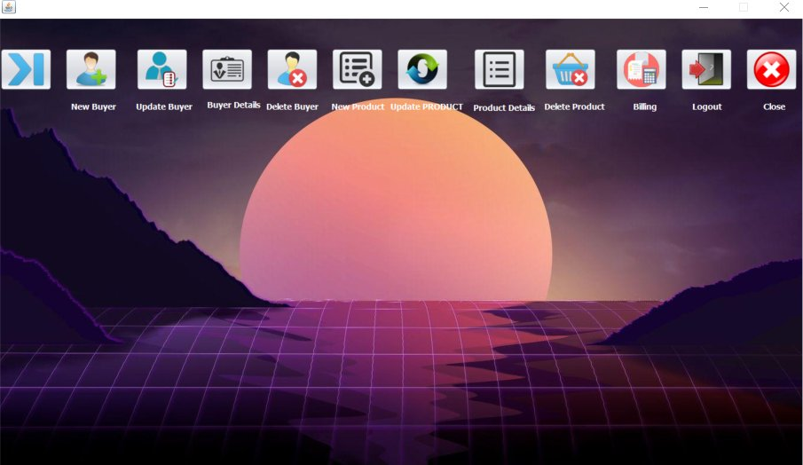
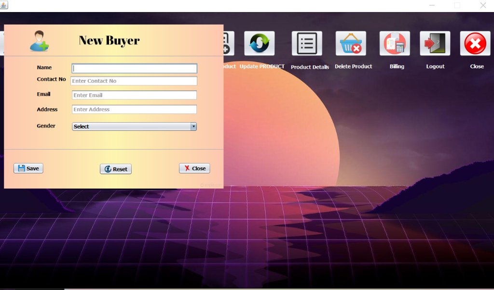
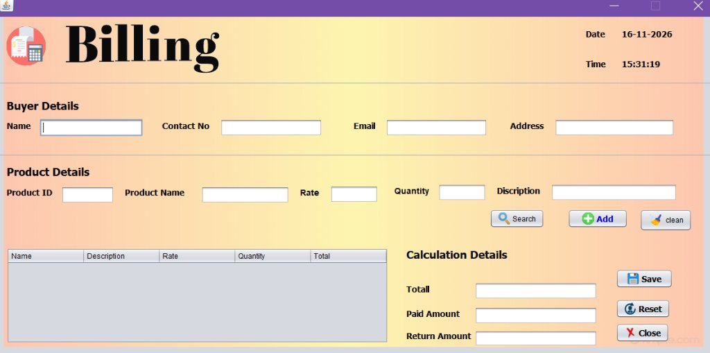

# Billing Management System

A desktop Point of Sale (POS) and inventory billing system built using Java Swing and MySQL. This system streamlines customer management, inventory control, real-time checkout calculations, and automated PDF invoice generation.

---

## Screenshots

### 1. Dashboard


### 2. Customer Registration


### 3. POS & Billing Terminal


---

## Features

- **Admin Login:** Protected entry point with password reveal toggle.
- **Collapsible Dashboard:** Animated navigation menu for accessing operations.
- **Customer Management:**
  - Register new buyers with validation (contact number, email, address).
  - Update, search, view in tables, and delete buyer profiles.
- **Product & Inventory Management:**
  - Create products with auto-generated IDs, pricing, and descriptions.
  - Update item details or set product availability status.
  - View full product listings with printing options.
- **Billing & Checkout:**
  - Quick auto-fill for customer and product details on input.
  - Itemized shopping cart table with automatic subtotal calculation.
  - Payment handling with change/return calculation.
  - Automated PDF invoice creation via iText.
  - Direct hardware printing via Apache PDFBox.

---

## Tech Stack & Libraries

- **Language:** Java (JDK 8 or higher)
- **GUI:** Java Swing, NetBeans Form Layout, FlatLaf (`FlatMacLightLaf`)
- **Database:** MySQL
- **Dependencies (included in `lib/`):**
  - MySQL Connector/J (`mysql-connector-j-8.4.0.jar`)
  - iText PDF (`itextpdf-5.5.6.jar`)
  - Apache PDFBox (`pdfbox-2.0.27.jar`, `fontbox-2.0.27.jar`)
  - rs2xml (`rs2xml.jar`)
  - FlatLaf (`flatlaf-3.4.1.jar`)
  - Log4j & Commons Logging

---

## Getting Started

### 1. Database Setup
1. Open your MySQL client (e.g., MySQL Workbench, HeidiSQL, or CLI).
2. Execute the provided script [bms.sql](bms.sql) to create the database schema:
   ```sql
   source bms.sql;
   ```

### 2. Configure Database Credentials
Copy `db.properties.example` to `db.properties` and add your MySQL database credentials:
```properties
db.url=jdbc:mysql://localhost:3306/bms
db.user=root
db.password=your_mysql_password
```
*(Alternatively, set the environment variables `DB_URL`, `DB_USER`, and `DB_PASSWORD`)*

### 3. Default Login Credentials
- **Username:** `bms`
- **Password:** `admin`

### 4. Running the Application
Open the project in **NetBeans IDE** (or your preferred Java IDE) and run `gui.login` or `gui.home`.

---

## License

Distributed under the MIT License. See [LICENSE](LICENSE) for more details.
